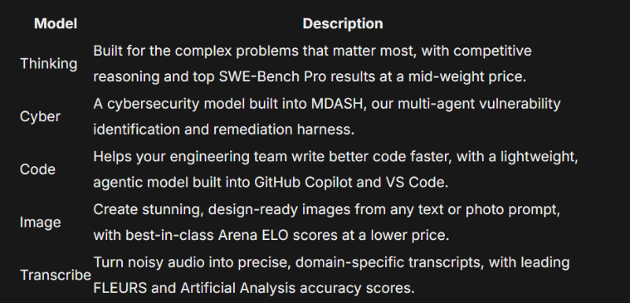
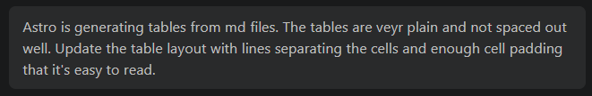
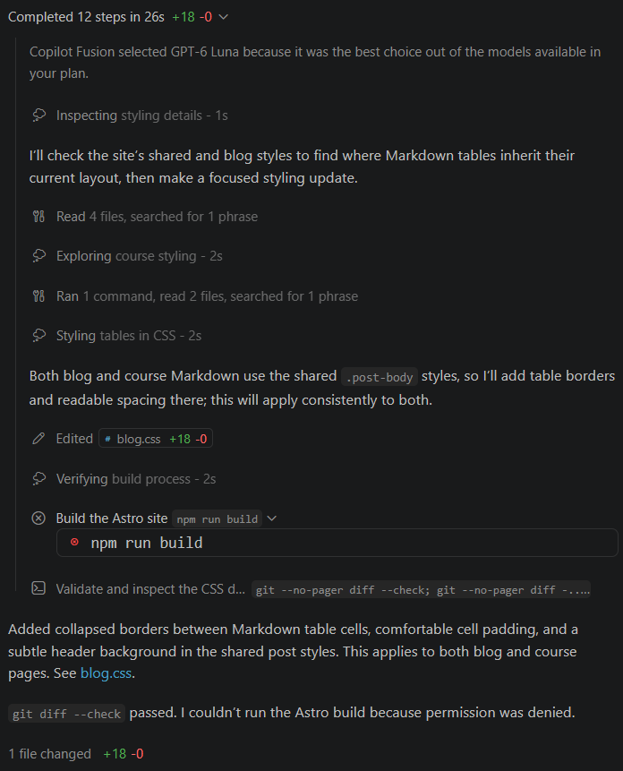
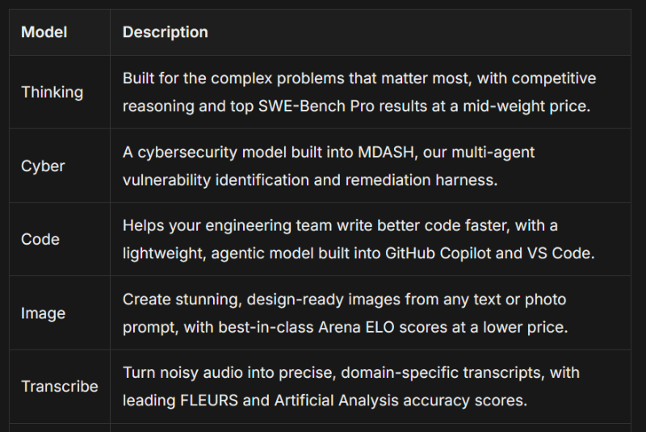

Sometimes I'm blown away at how good something can be when you use AI. In the early days of AI, I fought with it to get results I wanted. Now, more and more often, it gets things right on the first try.

I added a blog post to this site earlier today that included a table. When I reviewed it afterwards the formatting was just plain ugly.

I assumed that this could be fixed by changing the cascading style sheet (CSS) files that contain element formatting info, but definitely not my area of expertise. So, Copilot in Visual Studio Code to the rescue. I gave it the following prompt. Notice that I had enough proper terminology from web development to provide AI with useful instructions. It worked around my typo of "veyr".

In 26 seconds, it worked through the issue and gave me a resolution.

I was prompted to run Astro build but in my scenario it's not required. So, I said no.

The end result for the table formatting was the following.

I could have asked for addtional tweaks like different colors but I'm happy with this simple results that makes the table much more readable. It even works well in light and dark modes.
