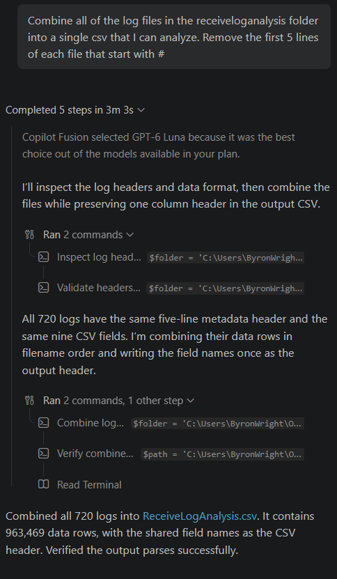
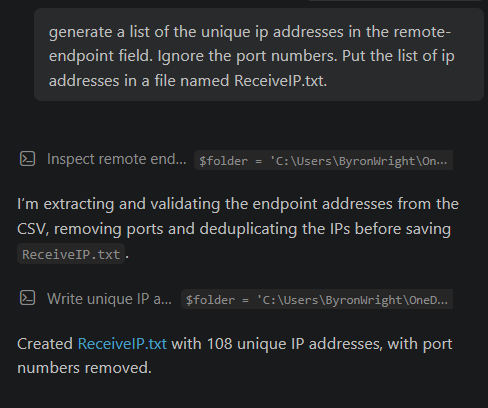
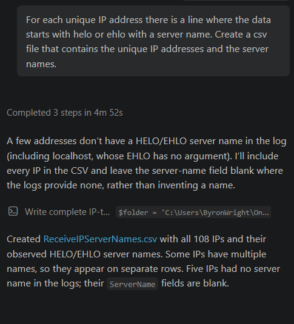
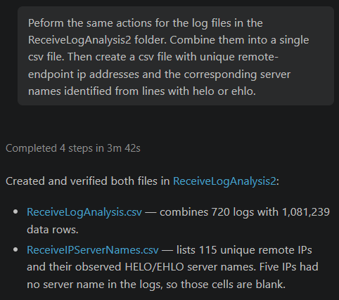

I'm working on an email server migration project. As part of that, I need to review log files to identify systems communicating with the email servers. I use this information to ensure that we know which systems might be impacted by taking existing email servers offline and update them with the new server information as necessary.

Some info on the log files:

- 720 log files x 2 servers (1 per hour for 30 days)
- Headers in the file have additional junk text that needs to be removed for proper importing as a CSV
- Remote server names are all stored in a data column but as part of a text field where they're difficult to extract

This seems similar to a coding project with data manipulation. So, I decided to try using Copilot in Visual Studio Code. This is all done without a paid subscription to Copilot.

First I asked Copilot to combine all of the files from one server into a single csv file. My plan A was to do this and then analyze in Excel like I normally would. Manually doing this would not be realistic and writing a script to do it would have taken quite a while. Copilot wrote several powershell scripts that got the job done in about 3 minutes.

With this combined log file, I could have done filtering and such in Excel, but with almost a million data lines. I figured that I Copilot might be faster. So, I asked for a list of unique IP addresses that were communicating with the mail server. The field containing IP addresses also contains port numbers (10.11.12.13:23456) that need to be ignored. If I did this in Excel, I would have used text-to-columns. Copilot took care of it all via PowerShell script.

Having IP addresses is nice, but not very user friendly to identify what systems are. The log has a data field that contains the server names, but it's not regularly formatted and working out the pattern to extract it would be hard.

Then since we processed the data for server 1, I asked it to run the same process on the logs for server 2. This time I provided less detail because Copilot knows what we've already done.

End result, about 2 million lines from log files analyzed and summarized to the information I needed in about 20 minutes. This saved me at least a few hours.

One of the keys is that you need to know what you want and provide sufficient detail in your request. I never asked to just extract server names or IP addresses. I told it where that necessary data way and how to extract it.

I did take the output from Copilot and did additional analysis in Excel where I used conditional formatting to identify duplicates. Excel skills still required also.

AI was a tool that increased my capacity and not a replacement for me.

If I were doing this on a regular basis, It's not efficient to ask Copilot to keep doing the same thing over and over. I would take the scripts it generates and make them part of my toolkit. Then I'd run them manually. That would also give me the ability to run the scripts directly in the environment with the log files instead of copying them out for analysis.
